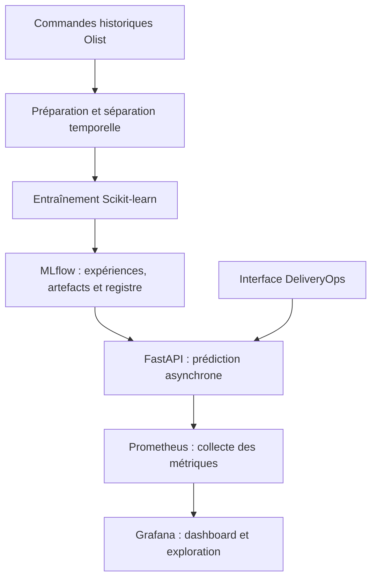

<div align="center">

# DeliveryOps

### Mini-projet n°12 — Pipeline MLOps : Industrialisation & Monitoring

**Anticiper les retards de livraison. Observer le modèle. Centraliser les outils.**

Python 3.12 · Scikit-learn · MLflow · FastAPI · Prometheus · Grafana · Docker Compose

[Installation](#installation) · [Interface](#interface-centralisée) · [Données](#données-et-problème-métier) · [Tests](#tests-et-démonstration)

</div>

---

## Présentation

Ce mini-projet n°12, réalisé dans le cadre de travaux de cours, industrialise un modèle de classification des retards de livraison e-commerce. Il couvre l’entraînement, le tracking, le registre de modèles, l’API REST asynchrone et la supervision continue. Une interface complémentaire regroupe les prédictions, l’évaluation et l’observabilité.

Le cas métier utilise **94 689 commandes réelles anonymisées issues d’Olist**, au Brésil entre 2016 et 2018. Les données préparées sont incluses : aucun compte Kaggle ni clé API ne sont nécessaires au lancement.

> Prototype pédagogique sur des données historiques. Le score sert à illustrer la chaîne MLOps ; il ne garantit pas le résultat d’une livraison. Le modèle n’est pas validé pour un usage commercial actuel ou pour un autre pays.

## Architecture



## Livrables demandés

| Livrable du sujet | Fichier |
|---|---|
| Orchestration MLflow, API, Prometheus et Grafana | `docker-compose.yml` |
| API REST validée et métriques Prometheus | `app/main.py` |
| Dashboard P95/P99, RPS, erreurs 5xx et drift | `grafana_dashboard.json` |
| Entraînement, suivi et registre de modèles | `app/train.py` |
| Interface complémentaire de centralisation | `app/static/` |

Les services disposent de healthchecks. Des volumes persistants conservent la base et les artefacts MLflow, les séries Prometheus et les données Grafana.

## Interface centralisée

**http://localhost:8000**

- Formulaire de commande : distance, poids, prix, transport, délai annoncé, articles, jour et mois.
- Trois exemples historiques : score faible, proche du seuil et élevé.
- Score de risque et décision, avec affichage du seuil réellement appliqué.
- État des services et version du modèle chargée depuis le registre.
- Latence P95/P99, débit et erreurs provenant de Prometheus.
- Dérive par variable sur les dernières observations.
- Simulations de trafic de référence et de dérive, arrêtables depuis l’interface.
- Précision, rappel, F1, ROC AUC, périodes d’évaluation et baseline.
- Importance globale des variables et dernières prédictions en mémoire.
- Accès à MLflow, Grafana, Prometheus et Swagger, y compris via les hôtes transférés de Codespaces.

Actualisation : cinq secondes. « — » signifie que la métrique n’est pas encore disponible. Le graphique de débit représente les relevés de la session du navigateur, jusqu’à cinq minutes ; l’historique persistant est dans Grafana/Prometheus.

## Installation

### Prérequis

Docker Desktop démarré en mode conteneurs Linux sous Windows, ou Docker avec Compose v2 sous Linux/macOS/Codespaces. Prévoir de la mémoire disponible pour les services (4 Go recommandés) et Internet pour le premier build. Les ports 8000, 5000, 9090 et 3000 doivent être libres.

Aucune installation locale de Python ni Node n’est requise.

### Windows — PowerShell, depuis le dossier extrait

```powershell
powershell -NoProfile -ExecutionPolicy Bypass -File .\start.ps1
```

Le script construit les images, attend les services, exécute les tests, génère du trafic et ouvre l’interface.

### GitHub Codespaces / Linux / macOS

```bash
bash start.sh
```

Dans Codespaces : déposer **tout le contenu** du projet à la racine du dépôt, y compris `data/` et `.devcontainer/`, puis créer le Codespace. Ouvrir le port **8000** dans l’onglet **Ports**. Les ports **5000**, **9090** et **3000** donnent accès aux outils. Garder les ports privés.

### Démarrage manuel

```bash
docker compose up -d --build
docker compose ps -a
docker compose logs --tail=80 train api
```

Le service `train` doit finir avec `Exited (0)` : son travail d’entraînement est terminé. Les quatre services permanents restent démarrés. Le premier build peut prendre plusieurs minutes.

| Interface | Adresse locale |
|---|---|
| DeliveryOps | http://localhost:8000 |
| Swagger | http://localhost:8000/docs |
| MLflow | http://localhost:5000 |
| Prometheus | http://localhost:9090 |
| Grafana | http://localhost:3000/d/projet12 |

Grafana : **admin / admin-projet12** (démonstration locale).

## Données et problème métier

Une commande est considérée en retard si son **jour de livraison réel est postérieur au jour de livraison annoncé**. La comparaison ignore l’heure, car la promesse est une date calendaire.

| Entrée | Définition |
|---|---|
| `distance_km` | Distance à vol d’oiseau vendeur–client, en km |
| `weight_kg` | Somme des poids des articles, en kg |
| `price_brl` | Somme des prix des articles, en réals brésiliens |
| `freight_brl` | Somme des frais de transport, en BRL |
| `promised_days` | Jours calendaires entre commande et date annoncée |
| `item_count` | Nombre d’articles |
| `purchase_weekday` | Lundi = 0, dimanche = 6 |
| `purchase_month` | Janvier = 1, décembre = 12 |

Les dates de livraison réelles, statuts finaux et avis clients ne sont jamais des entrées du modèle. Ils ne servent qu’au filtrage des historiques et à la construction de la cible. Le jeu ne contient que des commandes livrées et à vendeur unique : les annulations, les commandes non livrées et les commandes multivendeurs ne sont pas couvertes.

Source : [Brazilian E-Commerce Public Dataset by Olist](https://www.kaggle.com/datasets/olistbr/brazilian-ecommerce). Attribution, transformations et licence **CC BY-NC-SA 4.0** : [data/NOTICE.md](data/NOTICE.md). Empreintes de reproductibilité : `data/metadata.json`.

## Entraînement et évaluation

- Random Forest : 160 arbres, profondeur maximale 12, minimum 12 observations par feuille.
- Pondération `balanced_subsample` pour traiter le déséquilibre des classes.
- Séparation chronologique en trois périodes sans mélange d’une même date : premières 70 % des dates pour l’entraînement, 15 % pour la validation, 15 % pour le test. Les proportions de lignes diffèrent des proportions de dates.
- Seuil choisi sur la validation pour maximiser le F1 des retards, puis appliqué sans ajustement au test.
- Scores : précision/rappel/F1 des retards, accuracy équilibrée, ROC AUC et average precision.
- Baseline « toujours à l’heure » et fréquence des retards affichées pour éviter une lecture trompeuse de l’accuracy.
- Seuil inclus dans l’estimateur MLflow enregistré. `predict` et l’API appliquent la même politique.

Les résultats de la vérification figurent dans [VERIFICATION.md](VERIFICATION.md). Le rappel et la précision restent limités : ce modèle n’est pas présenté comme suffisamment fiable pour une décision logistique autonome. Les probabilités de la forêt ne sont pas calibrées.

MLflow conserve les paramètres, scores, signature, exemple d’entrée, statistiques de référence, matrice de confusion, importance des variables et description des périodes. Chaque entraînement crée une version et affecte l’alias `champion`. Cette promotion est pédagogique et automatique ; aucun processus d’approbation métier n’est simulé.

## Exemple d’appel API

`POST /predict`

```json
{
  "distance_km": 350.0,
  "weight_kg": 1.2,
  "price_brl": 150.0,
  "freight_brl": 25.0,
  "promised_days": 15,
  "item_count": 1,
  "purchase_weekday": 0,
  "purchase_month": 5
}
```

La réponse contient la classe (`on_time` ou `late`), le score de retard, les probabilités des deux classes, le seuil et la version chargée. Les champs entiers doivent rester des nombres entiers JSON. Les chaînes numériques, valeurs hors bornes et champs supplémentaires sont refusés avec HTTP 422.

## Tests et démonstration

```bash
docker compose run --rm --no-deps api python -m pytest -q
docker compose exec api python scripts/traffic.py --count 300
docker compose exec api python scripts/traffic.py --count 300 --drift
```

Le trafic de référence utilise de vraies lignes de caractéristiques d’entraînement. La dérive est une simulation volontaire de commandes beaucoup plus longues et lourdes, avec un délai annoncé réduit. Elle démontre le monitoring, pas un incident logistique réel.

Le drift compare les moyennes des 200 dernières requêtes aux moyennes d’entraînement, normalisées par l’écart-type. Il est calculé après 30 observations ; une variable au-dessus de 1,5 déclenche le drapeau. Relancer du trafic de référence remplace progressivement la fenêtre.

Cet indicateur surveille un décalage de moyenne, pas toutes les formes de dérive. Sans labels réels après livraison, l’API ne mesure ni l’accuracy en production ni le concept drift.

## Réentraînement

```bash
docker compose run --rm train
docker compose restart api
```

L’API charge une version fixe au démarrage. Le redémarrage est nécessaire pour charger le nouvel alias `champion`.

## Arrêt et persistance

```bash
docker compose down
```

Les volumes sont conservés. La fenêtre de drift et les 12 dernières prédictions sont en mémoire et sont réinitialisées au redémarrage de l’API. `docker compose down -v` supprime définitivement les volumes du projet.

## Organisation

```text
app/                 API, modèle, entraînement et interface
 data/               CSV préparé, métadonnées et attribution
 grafana/            Provisionnement de la source et du dashboard
 monitoring/         Collecte Prometheus et règles d’alerte
 scripts/            Préparation des données et génération du trafic
 tests/              Schéma, inférence, drift et séparation temporelle
 .devcontainer/      Configuration GitHub Codespaces
 docker-compose.yml  Orchestration et volumes persistants
 grafana_dashboard.json
 Dockerfile
 requirements.txt
 start.ps1
 start.sh
```

## Limites du déploiement

Les ports sont publiés sur la boucle locale. Ce projet ne configure pas TLS ni l’authentification de l’API et de MLflow. Les alertes sont visibles dans Prometheus ; aucun service de notification n’est configuré. Le code, les données et les scores ne constituent pas un service Olist officiel.
